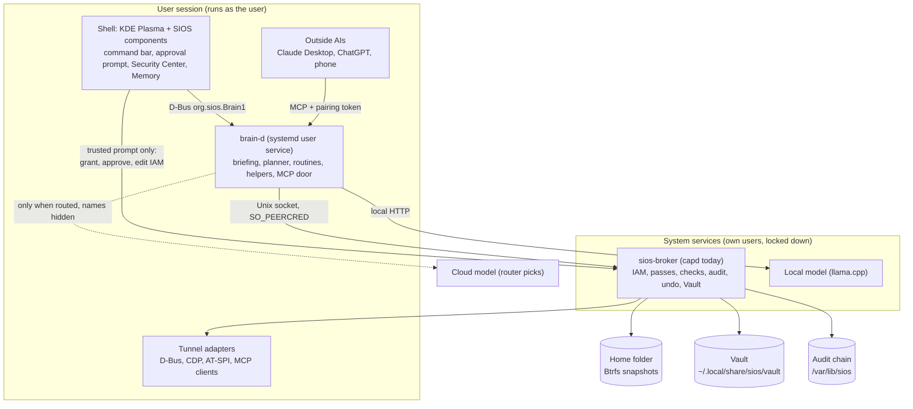
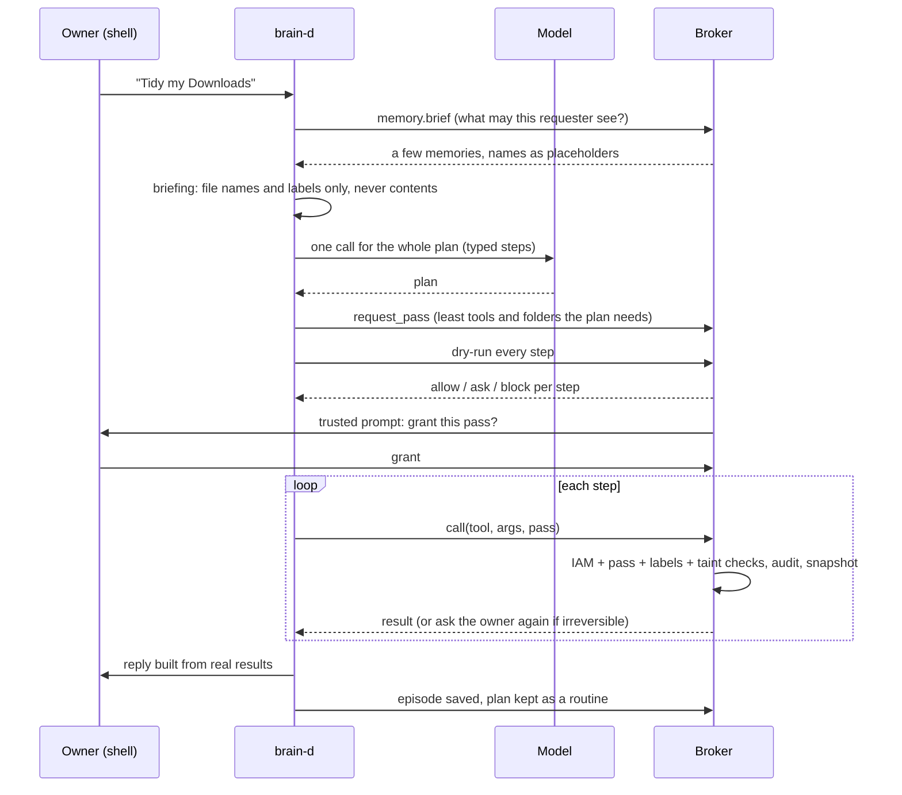
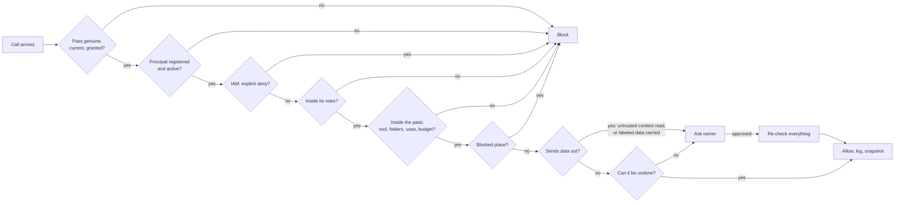
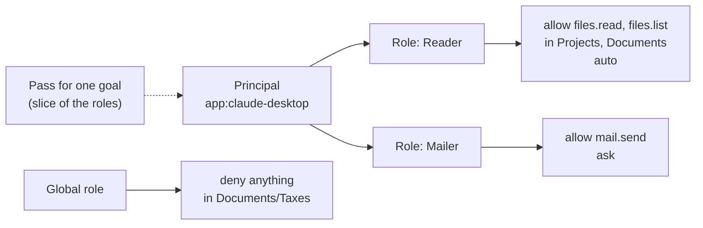

# 14. Design decisions and how they land on SIOS

Status: Living document. Started 2026-10-11 after a full audit of `capd`, `brain-d`, the simulated engine and memory.

This is the one place to read **why** SIOS is shaped the way it is, and **how** each choice becomes real on the Fedora build. The formal log stays in `11-decisions.md` (IDs, rejected options). The piece-by-piece mapping stays in `13-sim-to-fedora.md`. This file ties them together with diagrams.

How to read each decision: **Choice**, **Why**, **Digital version today**, **On SIOS**, **Open gaps**.

---

## 1. The whole system on SIOS

Key rule the picture encodes: **brain-d can ask, only the owner can grant, only the broker can act.** Nothing reaches files, memory, mail or settings except through the broker.

---

## 2. One request, end to end

---

## 3. How the broker decides

Every box is a pure function of facts, so any decision can be replayed and explained. The IAM boxes are proposed (D22); the rest runs today in `capd/src/policy.rs`.

---

## 4. Decisions

### Foundation (accepted, from the plan)

| ID | Choice | Why | On SIOS |
| --- | --- | --- | --- |
| D1 | Fedora Atomic + bootc, Aurora base | Image tooling, rollback, drivers done | Built and signed on ghcr.io (Phase 0) |
| D2 | Customized KDE Plasma | Wayland, D-Bus everywhere | Shell pieces become QML components |
| D3 | Rust for brain-d and broker | Safe, fast privileged services | Same code as the digital version |
| D9 | Flatpak for apps, image layers for system | Clean, updatable base | Store installs always ask |
| D10 | Open source core, paid extras | Trust for an OS with AI inside | License choice still open (TASKS) |

### The brain

| ID | Choice | Why | Digital version today | On SIOS | Open gaps |
| --- | --- | --- | --- | --- | --- |
| D4, D12 | brain-d (user service) plus a separate broker (system service) | brain-d never has more power than the user; credentials stay out of the model process | Two Rust processes; the page starts them | systemd units; broker at boot, brain-d per session | brain.sock has no auth yet (see D23) |
| D13 | Tunnel-first: make the computer easy for any AI, don't compete on models | Models improve on their own; access is the moat | Typed tools through capd | Same tools, real adapters | |
| D14 | The OS enforces, the model suggests | Makes small, cheap models reliable | Dry runs, typed args, valid tool names enforced | Same | Replies are model text, not built from results (D26) |
| D15, D5 | Hybrid models: local for private and everyday, cloud for hard tasks | Private by default | OpenAI only (D19) | llama.cpp + router | No router or consent before cloud |
| D11 | Reflex for fast decisions | Cheap, bounded | Not built | In brain-d | Classify, risk, tool filtering |
| D16 | Coarse, typed tools with shared types | Fewer steps and errors | `fs.*`, `mail.*`, `memory.*` with argument checks | Same names (rename `fs.*` to `files.*` once) | Args are JSON strings, not shared types |
| D6 | MCP both ways | Any AI can drive SIOS | `brain-d mcp` stdio server | Same, connections approved in the shell | Identity is self-reported (D23) |
| D19 | OpenAI drives testing until the local model lands | Owner's key; model only proposes | In use | Router replaces it | |

### Security

| ID | Choice | Why | Digital version today | On SIOS | Open gaps |
| --- | --- | --- | --- | --- | --- |
| D20 | Capability passes: signed, scoped, only narrower when handed on, revocable as a tree | Least power per goal, provable | `capd` tokens, 67 tests | sios-broker, same format | Pass holder can rename itself (fixed by D22) |
| | Approvals re-check before running | A pass revoked or an agent paused while waiting must not run | Done 2026-10-11 | Same | |
| | Broker state never inside the AI's reach | Keys and secrets must not be readable as files | capd refuses to start otherwise (2026-10-11) | `/var/lib/sios`, root-owned | |
| | Taint and data-flow labels | Content read from outside can't trigger sending; Finance and Sensitive don't leave quietly | Per goal in capd | Same, labels in xattrs | Labels lost on move and through memory (D24) |
| | Audit as a hash chain | Tamper-evident history | `audit.jsonl` | Signed chain | Several owner actions unlogged; writes fail open |
| D7, D17 | Adapter ladder; AI works in a hidden desktop | Structured access first, never fight the user | System tools carried out by the page | D-Bus, CDP, AT-SPI, hidden session | |

### Memory

| ID | Choice | Why | Digital version today | On SIOS | Open gaps |
| --- | --- | --- | --- | --- | --- |
| D8, D21 | Memory as records owned by the broker; per-AI groups; Sensitive never to online models; patterns saved only after the owner confirms | Same enforcement as files | `capd` memory module, Memory app, memsim | Vault, encrypted | No supersede (D25); substring recall |

---

## 5. Proposed decisions from the 2026-10-11 audit

These need the planning chat. When accepted they move into `11-decisions.md`.

### D22. Agent IAM (proposed)
- **Choice:** One identity and permission model for every AI.
  - **Principals:** stable ids such as `sios`, `helper:pip` and `app:claude-desktop`. Each has a kind, a creator, how it proves itself, its roles, and whether it is active or paused.
  - **Roles:** made of allow and deny statements over tools, folders, memory groups and conditions. Each statement is either auto or ask.
  - **Passes:** a pass is a slice inside the role, and an explicit deny always wins.
  - **Irreversible actions always ask**, whatever a role says.
- **Why:** Today a principal is any string, so a pass can be handed on under another AI's name and read that AI's memory. Permissions are also spread over six places: passes, rules, shares, the pause list, trust levels and the Access map.
- **On SIOS:** the registry and roles live in `/var/lib/sios/iam.json` and can be edited only from the trusted prompt. Standing rules and memory shares become statements.

### D23. Proving who is calling (proposed)
- **Choice:**
  - Outside AIs prove their identity with a pairing token that the owner issues; the name a client reports is not enough.
  - `brain.sock` needs the shell's secret for owner actions: starting goals as the owner, adding helpers, changing privacy.
  - On SIOS, both sockets use `SO_PEERCRED` and systemd unit identity.
- **Why:** Today any local program can start a goal as the owner, and any MCP client can claim to be another.

### D24. Labels follow the data everywhere (proposed)
- **Choice:** Folder labels (Finance, Sensitive, untrusted) stay with a file when it is moved out of the folder. A memory saved from labeled content carries that content's labels. Taint is tracked per goal, not per pass.
- **Why:** Today two paths drop the label: moving a file out of a Finance folder, and saving its contents as a memory. Either way the data can later leave the computer with no warning.

### D25. Memory that changes its mind (proposed, from ideas.md)
- **Choice:**
  - A newer fact about the same subject supersedes the old one: the old fact is kept as history and drops out of recall.
  - Episodes can't crowd out facts.
  - A learned habit is re-checked when a fact it depends on changes.
  - Recall moves from substring matching to word and meaning search, with a minimum relevance score.
- **Why:** memsim fails 5 of its 6 checks over six months because old facts keep winning.

### D26. Fewer tokens by design (proposed)
- **Choice:**
  - Order the briefing so the parts that rarely change come first and get cached.
  - Send only the tools a request needs, using Reflex.
  - Let routines take parameters and match on intent rather than exact wording.
  - Let outside AIs submit typed plans directly, so the work isn't planned twice.
  - Build the reply from the real results.
  - Set a minimum relevance score for memories.
- **Why:** This is the thesis: the architecture should let models do more with less. Today one plan re-sends roughly 2 to 8 thousand tokens, and every re-plan sends everything again.

---

## 6. Build order

| Stage | What | Status |
| --- | --- | --- |
| 0 | Definite bugs: approval re-check, secret checks, memory fixes, honest Security UI | Done 2026-10-11 |
| 1 | IAM core in capd, identity proof (D22, D23), migrate rules, shares and pause | Next |
| 2 | Sim reads the same IAM; Security Center: Identities, Roles, what-if simulator | |
| 3 | Labels follow data (D24) | |
| 4 | Memory supersede, recall, Memory app (D25) | |
| 5 | Token work (D26) | |
