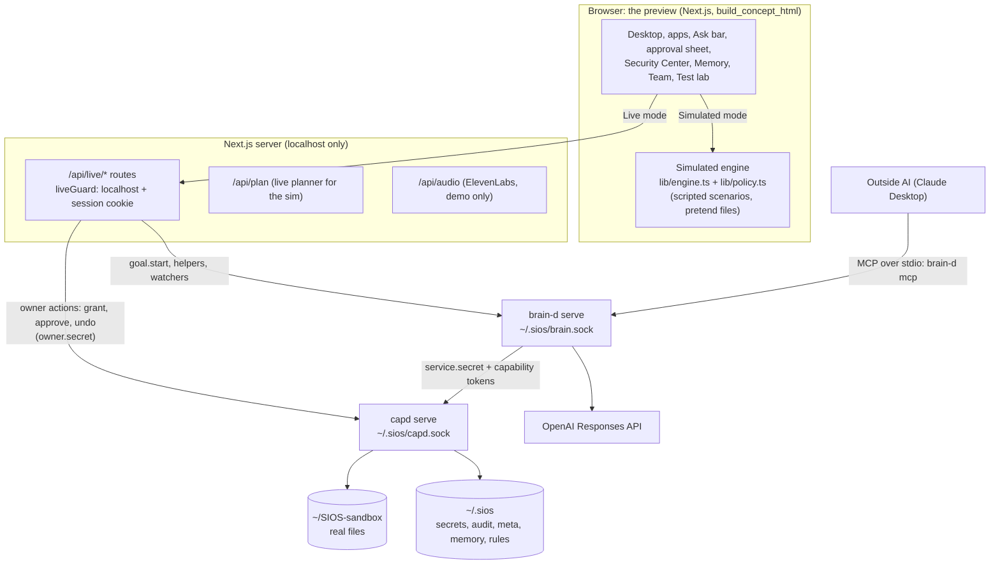
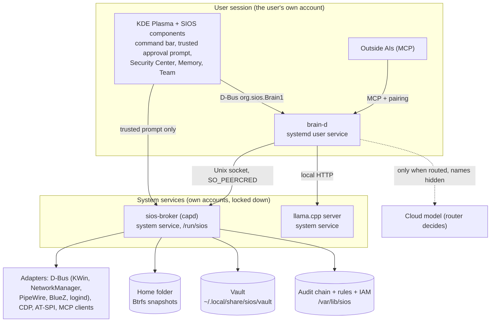
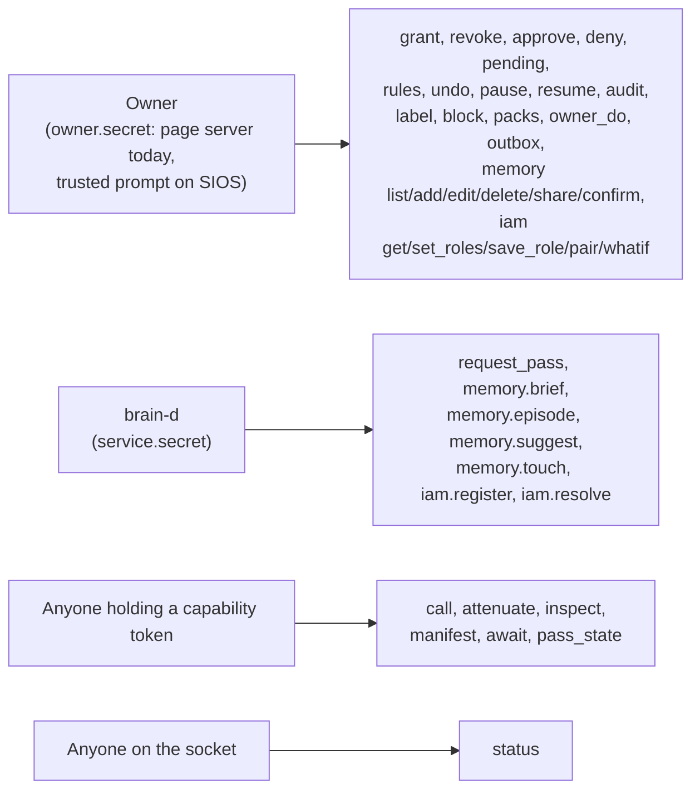
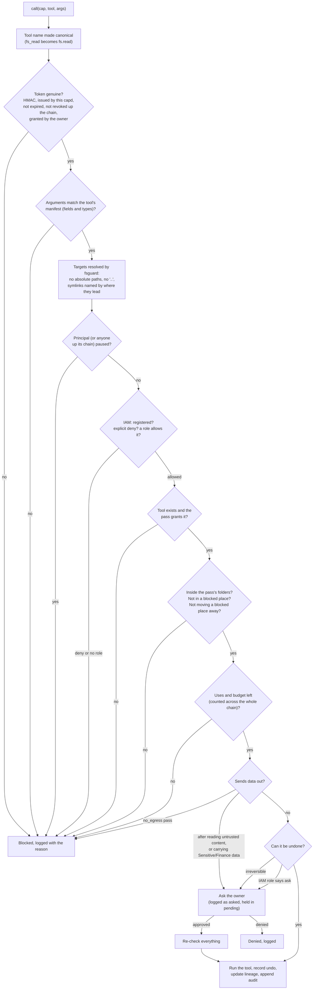
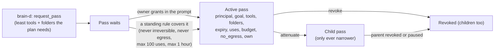
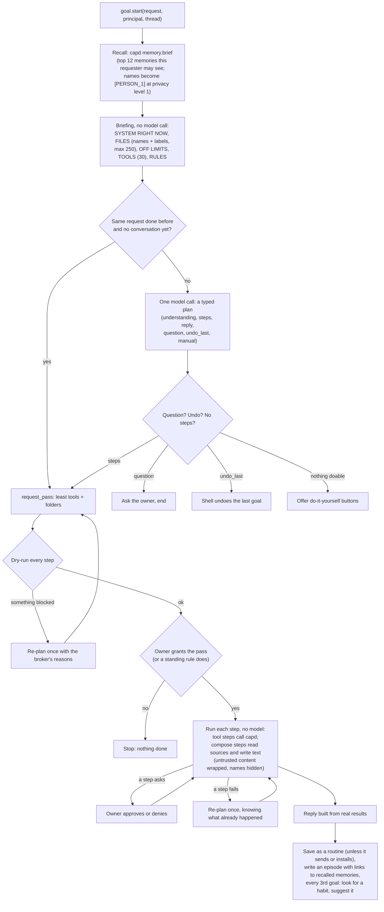
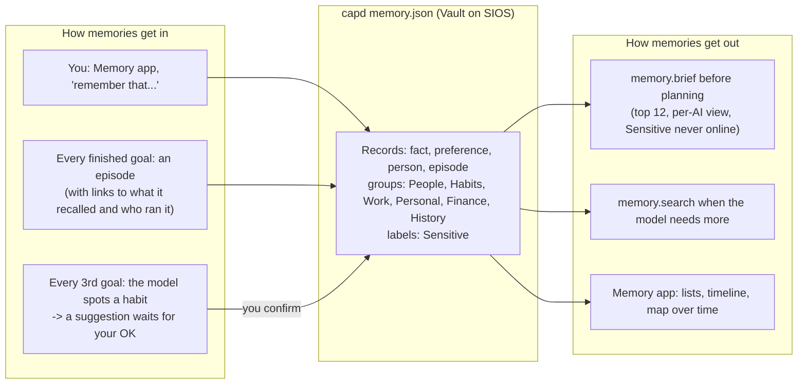
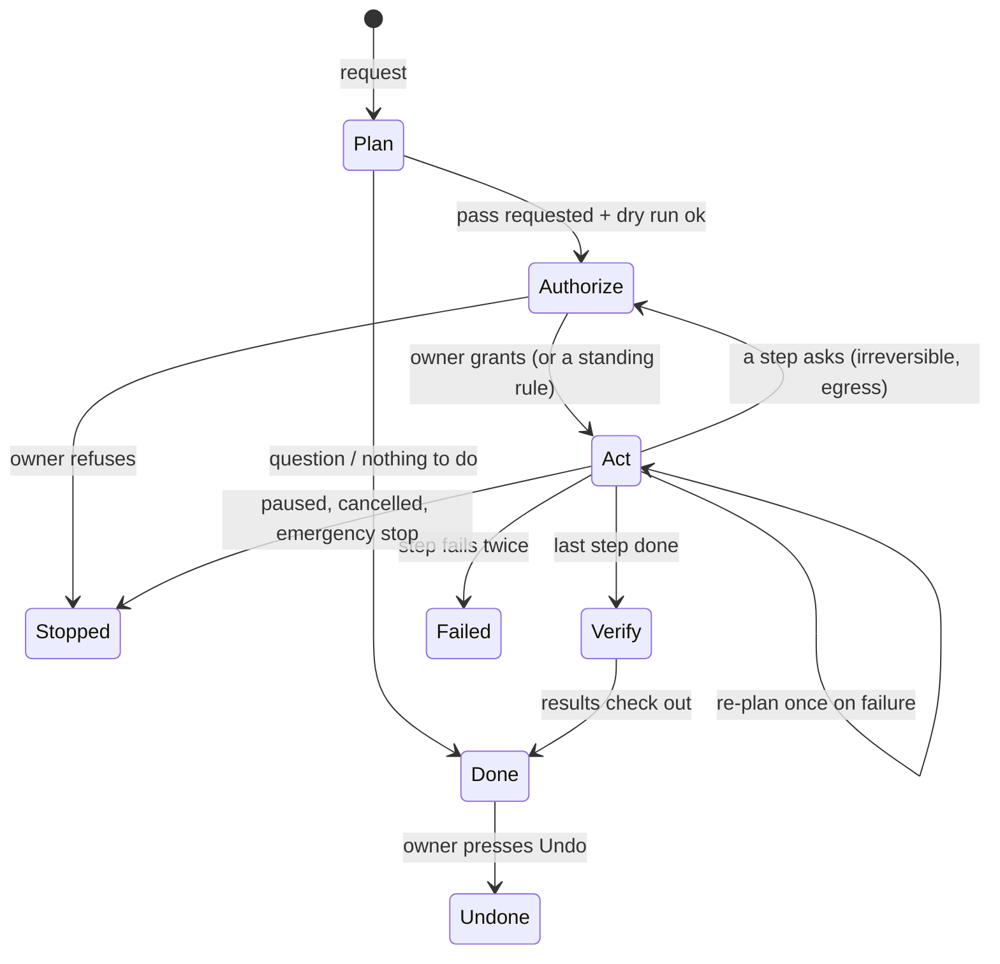
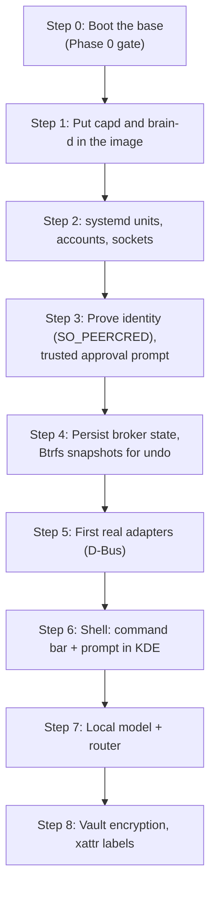

# 15. Build blueprint: from the digital version to a real machine

Status: Living document. Written 2026-10-12 from a full read of `capd`, `brain-d`, the preview (`build_concept_html`), the plan docs and the image build.

This is the one document to follow when SIOS moves from the Mac preview onto the `.iso` and a real device. It connects every piece with diagrams: what runs, how it decides, where data lives, what is proven, and what is not.

Read with it:
- `14-design-decisions.md`: why each choice was made (D1 to D21 accepted, D22 to D26 proposed).
- `13-sim-to-fedora.md`: the row-by-row mapping of every piece.
- `11-decisions.md`: the formal decision log.

How to read the diagrams: solid arrows are calls that happen today; dotted arrows are planned. "Today" means the digital version on the Mac. "On SIOS" means the Fedora image.

---

## 0. Where we are, in one screen

| Area | Today (digital version) | On the real machine |
| --- | --- | --- |
| Base image | Builds on GitHub Actions, signed, ISO built once (2026-09-28) | **Never installed or booted.** Every Phase 0 gate is open. |
| Security engine (`capd`) | Rust, 72 tests pass, real files in a sandbox folder | Not packaged, no systemd unit, no real identity checks |
| AI agent engine (`brain-d`) | Rust, 8 tests pass, drives real GPT through `capd` | Not packaged, no D-Bus, no local model |
| Shell | Next.js page that plays the desktop | KDE Plasma components not started |
| Memory | Inside `capd`, plain JSON, per-AI views | Vault (encrypted) not started |
| Tests | Unit tests, confusion test (19 cases), memory simulation, headless UI runs | Nothing has run on Fedora |

The honest summary: **the brain and the broker work and are well tested as programs. Nothing has been proven on the operating system they are meant to live in.** The build steps in section 9 close that gap in order.

---

## 1. The whole system: today and on SIOS

### 1a. Today, on the Mac



Two modes share one screen:
- **Simulated:** everything is pretend. `lib/policy.ts` copies the broker's rules so demos look right.
- **Live machine:** real model, real files in `~/SIOS-sandbox`, every action through `capd`.

### 1b. On SIOS



The rule both pictures encode: **brain-d can ask, only the owner can grant, only the broker can act.**

---

## 2. The engines and how they talk

| Engine | What it is | Runs as (today / SIOS) | Talks over | Holds |
| --- | --- | --- | --- | --- |
| Shell | What people see and click | Browser page / KDE components | HTTP to the page server / D-Bus | Nothing secret |
| Page server | Plays the trusted parts of the OS for the preview | Next.js on localhost / (gone; the shell and systemd take over) | Unix sockets to brain-d and capd | Session cookie, `owner.secret` read from disk |
| brain-d | The AI agent engine: briefing, planning, running plans, memory recall, helpers, watchers, MCP door | Your user / systemd user service | `brain.sock` (JSON lines), MCP stdio | `service.secret`, OpenAI key (never sent to capd) |
| capd | The security engine: passes, checks, tools, undo, audit, memory, IAM | Your user / its own system account | `capd.sock` (JSON lines) | `capd.key`, `owner.secret`, `service.secret`, rules, IAM, audit, memory |
| Model | Turns a request plus a briefing into a typed plan | OpenAI Responses API / llama.cpp locally, cloud when routed | HTTPS / local HTTP | Nothing kept |

Wire format everywhere today: one JSON object per line, `{method, params, ...}` in, `{"ok": ...}` or `{"error": ...}` out.

Who may call what on `capd`:



---

## 3. The security engine (capd)

### 3a. One call, every check, in order

This is what happens inside `capd` for `call {cap, tool, args}` (`state.rs` `call` then `assess`, `policy.rs` `evaluate`). The first failure blocks.



Dry runs (`dry_run: true`) go through the same checks but run nothing, log nothing and spend nothing. brain-d dry-runs every step of a plan before asking for a pass.

### 3b. Capability tokens (passes)



- Format: `base64url(json).base64url(HMAC-SHA256)`, key in `capd.key`.
- A child can never add tools, widen folders, outlive its parent, gain `own`, drop `no_egress`, or exceed its parent's uses or budget (`token.rs` `check_narrower`).
- Handing a pass to a different AI only works if that AI was created by the parent's principal (`attenuate`).
- `own` (may see the owner's private memory) is decided by where a goal came from, never by its name.
- A pass asking for the whole home folder needs `whole_home: true`; brain-d only sets that when a plan has a step with no folder.

### 3c. Tools and their risk levels

| Level | Tools | Broker behavior |
| --- | --- | --- |
| Read | fs.list, fs.read (64 KB cap), fs.find (30 hits, no links), memory.search, people.resolve, ui.open_app, ui.show_folder, ui.quick_look, ui.notify, ui.close_app, ui.focus_app, ui.side_by_side | Allowed and logged |
| Reversible | fs.write, fs.move, fs.copy, fs.trash, fs.organize (1 to 200 moves, all or nothing), fs.mkdir, fs.restore, ui.set_theme, ui.set_wallpaper, net.connect_wifi, net.wifi, net.bluetooth, sys.set_volume, sys.set_brightness, sys.dnd, sys.lock, sys.remind, memory.save, memory.forget | Allowed inside a granted pass, undo recorded |
| Irreversible | mail.send (the only egress tool), fs.delete (only inside `.Trash`), store.install, store.remove | Always asks the owner, every time |

`ui.*`, `sys.*`, `net.*` and `store.*` return an `effect` for the shell to carry out. On SIOS they become broker adapters over D-Bus (KWin, PipeWire, PowerDevil, NetworkManager, BlueZ, logind, Flatpak).

Undo kinds: Restore (a backup under `snapshots/<op>/before`), Remove, MoveBack, Many, RemoveDir, MemRemove, MemRestore. `undo GOAL` reverses a whole goal, newest change first.

### 3d. Labels, trust and data flow

- Every file can carry labels (Work, Personal, Finance, Sensitive) and a trust mark (untrusted: from the web or email). They live in `meta.json` and flow down folders.
- Files a goal writes inherit the labels and trust of what it read (lineage).
- Reading untrusted content **taints** the goal: anything it then sends out asks.
- Sending data that carries Sensitive or Finance labels asks, and the prompt names the data.
- **Blocked places** (for example `Documents/Taxes 2025`) are unreachable by any pass, through links, or by moving them away.

### 3e. Agent identity and roles (IAM)

- Every AI is an identity with roles. A role is a list of statements: allow or deny some tools, in some places, under some conditions (risk, taint), in "auto" or "ask" mode.
- Global roles apply to every AI. **An explicit deny wins.** Nothing that fits no allow is allowed.
- `helper:` and `app:` identities register themselves on first use; `app:` gets no roles until the owner gives some.
- Fixed 2026-10-12: deny statements now fire on any overlap with the denied place. That includes the folder that contains it, a move that only partly touches it, and a file tool with no place named. Before this, acting on the parent folder slipped past a deny. Test: `iam.rs` `roles_allow_deny_and_default_no`.
- Proposed (D22, D23): prove who is calling with `SO_PEERCRED` and pairing tokens instead of names.

### 3f. Audit and secrets

- `audit.jsonl`: one entry per decision `{seq, at, principal, cap, tool, target, decision, reason, checks, prev, hash}`. Each hash covers the entry and links to the previous one, so any edit or deletion is detected (`verify`).
- Decisions logged: allowed, asked, approved, denied, blocked, you.
- Secrets (`capd.key`, `owner.secret`, `service.secret`) are created private (0600) in a private folder (0700). capd refuses to start if they are readable by others, too short, or if its state folder sits inside the sandbox.
- Credentials never enter model context or memory. Memory refuses anything that looks like a password, key, token or card number.
- A crash inside one request is caught and answered with an error; capd keeps serving.

---

## 4. The AI agent engine (brain-d)

### 4a. One goal, start to finish



Events the shell follows: recall, brief, plan, question, undo, replan, review, granted, step, ask, effect, done, error.

What makes it fast and safe:
- **One model call per plan.** Running the plan needs no model, except to write text for compose steps.
- **Routines:** a request seen before reuses the plan with no model call. Plans that send, install or remove apps are never reused.
- **Placeholders like `{{1}}`** (text written by the model) can never become a path, so generated text can't steer where files go.
- **The pass covers only what the plan needs.** A new file maps to its folder, never to the whole home.

### 4b. Who can start a goal

| Origin | Principal name | Sees your private memory (`own`) |
| --- | --- | --- |
| You, in the shell | owner (shown as "<model> (via brain-d)") | Yes |
| A watcher on a folder | `Watcher (<folder>)` | Yes |
| A helper pet | `<Name> (helper)` | Yes |
| An outside AI over MCP | `<client> (MCP)` | No: only the groups you shared with it |

### 4c. Helpers, watchers and the MCP door

- **Helpers (the pet team):** each helper is its own identity with one long-running job: watch a folder, run every N minutes, or one big job. Every run is an ordinary goal: briefed, planned, checked, asking when it must. Brain slots: OpenAI connected; Claude, Muse and a local model reserved.
- **Watchers:** new files in a folder start a goal. Polling every 3 seconds today; inotify on SIOS.
- **MCP door** (`brain-d mcp`): outside AIs get `sios_do`, `sios_goal_status`, `sios_briefing`, `sios_recall` and the `sios://briefing` resource. They go through the same pipeline and the same broker as you, with less memory.

### 4d. Model layer

- Today: the OpenAI Responses API with strict JSON schemas (`model.rs`), model from `OPENAI_MODEL` (default `gpt-5.5`), 120 second timeout.
- On SIOS (D5, D15): a router picks a local llama.cpp model for everyday and private work and a cloud model for hard tasks, always with names hidden. Not built.

---

## 5. Memory (the Vault)



- Ranking: words in common, then how often used, then how recent (days back from the newest memory; fixed so it never wraps).
- 200 episodes kept; the oldest are cleared first, like page reclaim.
- Each outside AI sees only the groups you share with it. Sensitive memories never go to an online model.
- **Known weakness, proven by `capd memsim`:** a newer fact does not replace an older one. Over six simulated months, 5 of 6 memory checks fail after you change your mind (new accountant, new city, new folder). Fix designed as D25, not built.

---

## 6. How the file system is organized

### 6a. Today

```
~/SIOS-sandbox/                 the AI's whole world (SIOS_ROOT)
  .sios-sandbox                 marker: only a marked folder can be wiped by test packs
  .Trash/                       trash; fs.delete only works in here
  Documents/ Downloads/ Projects/ Pictures/ ...
~/.sios/                        state (SIOS_STATE), folder 0700
  capd.key owner.secret service.secret   0600, refused if loose
  capd.sock brain.sock                    0600
  audit.jsonl                   hash-chained decisions
  meta.json                     labels, trust, origin, lineage, blocked places
  memory.json                   memories, suggestions, shares
  rules.json iam.json           standing rules, identities and roles
  people.json                   contacts (imported into memory once)
  outbox/                       mail.send writes here
  snapshots/<op>/before         undo backups
  routines.json watchers.json helpers.json   (brain-d)
  memsim/                       memory simulation runs
build_concept_html/.cache/audio demo narration and sounds (git-ignored)
```

### 6b. On SIOS

| What | Where | Why |
| --- | --- | --- |
| Binaries (`capd`, `brain-d`, shell parts) | `/usr/bin`, `/usr/lib/sios` in the image | Read-only, updated as a whole image, rolled back with `bootc rollback`. Never written at runtime (core rule 6). |
| Machine config | `/etc/sios` | Admin-editable, survives updates |
| Broker state: keys, audit, rules, IAM | `/var/lib/sios`, owned by the broker's account | The user's programs can't edit it |
| Broker socket | `/run/sios/broker.sock` | Callers identified by `SO_PEERCRED` |
| brain-d socket | `$XDG_RUNTIME_DIR/sios` | Per user session |
| Models | `/var/lib/sios/models` | Big files outside the image |
| Vault (memory), routines, preferences | `~/.local/share/sios/` (encrypted) | The user's data stays in their home |
| Labels and trust | Extended attributes on files, plus a Vault index | Labels travel with the file |
| Undo | Btrfs snapshots of the home subvolume | Persistent, cheap, survives restarts |
| Trash | freedesktop Trash, snapshotted | What KDE already uses |

---

## 7. Goal processes: what they are and the plan

A goal is to SIOS what a process is to Linux: it has an owner, a slice of authority (its pass), a budget, a state and a log. Today the shell's Goals app shows them; brain-d runs them as threads.



What exists today:
- **brain-d:** one thread per goal, events in order, `goal.events` to follow along, recent goals list, helpers as repeating goals, watchers as triggered goals.
- **Simulated engine:** parent goals with sub-goals handed to other AIs with narrower passes, file locks between agents, budgets (cents and actions), data lineage flowing up from sub-goals, emergency stop, cancel from the Goals app.

The plan for SIOS (proposed; needs a decision before building):

| Piece | Plan |
| --- | --- |
| Process | Each goal runs as a systemd transient unit (`sios-goal@<id>`) under brain-d's user slice, with cgroup limits on CPU, memory and time |
| Identity | The unit's credentials identify the goal to the broker (`SO_PEERCRED` plus the pass), so a goal can't claim to be another |
| Authority | One pass per goal; sub-goals get attenuated passes; revoking a parent stops its children |
| Budget | Actions and model cost counted by the broker, not by the goal |
| Stop | Emergency stop = broker refuses every pass + `systemctl stop` on every goal unit |
| Survive restart | Passes, pending approvals and the undo stack persisted in `/var/lib/sios` (today they are lost when capd restarts) |
| Helpers | One systemd timer or inotify watch per helper, each starting a goal unit |
| Visibility | Goals app reads from brain-d over D-Bus and from the broker's audit |

---

## 8. What we have tested, and what we have not

### 8a. Tested (with evidence)

| What | How | Result |
| --- | --- | --- |
| capd security rules | 72 Rust unit tests (`cargo test` in `capd`): tokens, forging, expiry, uses, budget, attenuation, revocation cascade, pausing, blocked places, symlinks, traversal, egress and taint, re-check on approve, undo, trash, standing rules, secrets, memory views, IAM | All pass (2026-10-12) |
| brain-d logic | 8 Rust unit tests: least-privilege passes, placeholders can't become paths, compose text is safe, briefing hides blocked places and doesn't follow links, routines, name redaction, helper validation | All pass |
| Real model through the real broker | Confusion test, 19 cases in the Test lab (two Saras, typos, missing files, contradictions, off-limits, vague, many parts, system settings, follow-ups, undo, hidden instruction, 500 files, reminder, install refused, remember then use, secret refused, Sensitive held back, undo a remember, gibberish) | 19 of 19 passed on 2026-10-09 with GPT |
| Live runs | `capd/harness/live-run.mjs`, records in `capd/runs/` | Summarize, tidy, email goals; audit chain intact |
| Memory over time | `capd memsim` (scripted 1 month to 1 year, optional GPT) | Privacy held every week; 5 of 6 memory checks fail after changes of mind (known, D25) |
| Shell flows | Headless browser runs: live machine switch, test packs, pets and quiet tray, memory map, memory simulation, the "A week with SIOS" demo with sound | All completed with no page errors |
| Image pipeline | GitHub Actions build, cosign signing, anonymous pull, one ISO built (about 5.2 GB) | Works |

### 8b. Not tested yet

Nothing below has ever run. Each is a risk until proven.

| Area | Not yet proven |
| --- | --- |
| The OS itself | ISO install, first boot, KDE session, `bootc upgrade`, `bootc rollback`, a real laptop (Wi-Fi, GPU, sleep). All Phase 0 gate items are open. |
| Packaging | capd and brain-d built into the image, systemd units, the broker's own system account, socket permissions under `/run/sios` |
| Identity | `SO_PEERCRED` caller checks; today identity is "who can read a secret file" |
| Persistence | Passes, approvals and undo across a capd restart (all lost today) |
| Real system tools | D-Bus adapters for theme, volume, brightness, Wi-Fi, Bluetooth, windows, lock, reminders; today capd only returns an effect for the page to show |
| Real mail | Gmail or IMAP send; today mail goes to `~/.sios/outbox` |
| Snapshots | Btrfs snapshots for undo; today backups are copied files |
| Labels on disk | Extended attributes; today `meta.json` |
| Encryption | Vault and broker state encrypted at rest |
| Local model | llama.cpp service, the router, Reflex, a model small enough for a laptop |
| Real shell | KDE command bar, trusted approval prompt (polkit-style), Security Center as native components |
| Outside AIs for real | Claude Desktop connected to the MCP door on a real machine |
| Code paths with no unit tests | `brain-d` goal.rs (the pipeline), mcp.rs, model.rs; `capd` tools.rs and main.rs (covered only indirectly through state.rs tests) |
| Scale and load | Thousands of files (the briefing caps at 250 entries), many goals at once, long uptime |
| Windows apps | Phase 5, not started |
| arm64 | Aurora is amd64 only; test devices must be x86_64 |

### 8c. Known gaps to close before trusting it with real data

1. **Identity by secret file.** Anyone who can read `owner.secret` is the owner. On SIOS the trusted prompt must be the only owner path, checked with `SO_PEERCRED`.
2. **State lost on restart.** Passes, pending approvals and undo live in memory.
3. **Some state files are world-readable (0644)** on the dev machine: `audit.jsonl`, `meta.json`, `memory.json`, `rules.json`. They must be private on SIOS.
4. **Memory doesn't change its mind** (D25).
5. **Planner scale:** the briefing lists at most 250 entries.
6. **No process isolation:** brain-d and capd run as the same user today.

---

## 9. The build path to a real device

Follow these in order. Each step ends with a gate that must pass on a VM or real hardware before the next one starts (CLAUDE.md: a phase is done only when every gate passes on a VM or real hardware).



### Step 0. Boot the base (Phase 0)
- Hardware: an x86_64 machine or VM (Aurora is amd64 only). VirtualBox on the Windows PC, or a spare laptop.
- Build the ISO with `build-disk.yml` (manual run). Fix first: the workflow uploads one artifact name for both ISO and qcow2, so the last job wins.
- Install, log in, check KDE, Wi-Fi, GPU, sleep.
- Push a change, run `bootc upgrade`, reboot, check it applied; run `bootc rollback`, reboot, check it reverted.
- **Gate:** the four Phase 0 gate items in `docs/phases/phase-0.md`.

### Step 1. Put capd and brain-d in the image
- Add a build stage to the `Containerfile` that compiles both crates (`cargo build --release`) and copies the binaries to `/usr/bin` in the final image. Nothing is written to `/usr` at runtime.
- Run `cargo test` for both crates in CI before the image is pushed; a failing test stops the build.
- **Gate:** `capd help` and `brain-d` run on the installed machine.

### Step 2. systemd units, accounts and sockets
- `sios-broker.service`: a system service running capd as its own account (`sios-broker`), state in `/var/lib/sios` (0700), socket `/run/sios/broker.sock`.
- `brain-d.service`: a user service, socket in `$XDG_RUNTIME_DIR/sios`.
- Map today's `SIOS_STATE` and `SIOS_ROOT` to these folders, and the sandbox to the real home folder (first on a test account only).
- Ship units and default config through `system_files/` (today it holds only `.gitkeep` files) and enable them in `build_files/build.sh` (today still the template).
- **Gate:** after a reboot both services are up; a `status` call works; the live-run harness passes against them on the VM.

### Step 3. Prove identity and add the trusted prompt
- capd reads `SO_PEERCRED` on every connection: brain-d's user and unit, the trusted prompt's binary, outside AIs only through brain-d (D23).
- Replace the page server's owner role with a small trusted approval agent (polkit-style) that alone may grant, approve and edit rules and IAM.
- **Gate:** a process that reads no secret but connects to the socket cannot grant anything; the security tests are rerun against the service.

### Step 4. Persist broker state and real undo
- Store passes, pending approvals and the undo journal in `/var/lib/sios`; reload on start.
- Undo by Btrfs snapshot of the home subvolume (trash first, as today).
- Make every state file private (fixes gap 3).
- **Gate:** restart capd mid-goal; the goal resumes or fails cleanly; undo still works after a reboot.

### Step 5. First real adapters
- Start with the three Phase 2 gate tasks: Wi-Fi (NetworkManager), dim the screen (PowerDevil), organize Downloads (already real).
- Each adapter runs inside the broker after the checks pass; the model never touches D-Bus.
- **Gate:** Phase 2 gate: those three work with approvals and undo.

### Step 6. Shell in KDE
- Command bar, approval prompt, task progress and Security Center as native KDE components talking D-Bus `org.sios.Brain1`.
- The preview stays the design reference: same words, same flows (see `13-sim-to-fedora.md` "Flows that must stay identical").
- **Gate:** the confusion test passes from the real command bar.

### Step 7. Local model and router
- llama.cpp as a system service, models in `/var/lib/sios/models`; brain-d's model layer gains a local provider and a router (D5, D15).
- **Gate:** Phase 1 gate: the command bar answers with networking off; a hard request goes to the cloud only with consent.

### Step 8. Vault and labels on disk
- Encrypt memory and routines under `~/.local/share/sios/vault`; labels as extended attributes; then D25 (memory that changes its mind).
- **Gate:** Phase 3 gate ("Email my team" resolves people; redaction verified), plus `capd memsim` with the D25 fix showing changes of mind passing.

### Rules for every step
- One small verifiable step at a time; plan first, then build.
- Tick the task in `TASKS.md` and the phase file; add what was learned.
- Every plan change: one dated line in `changelog.md`, own `plan:` commit.
- Keep the digital version in step: when a piece lands on SIOS, update its row in `13-sim-to-fedora.md`.

---

## 10. Decision index

| ID | Decision | Status |
| --- | --- | --- |
| D1 | Fedora Atomic + bootc, built FROM Aurora (KDE) | Accepted |
| D2 | Customized KDE Plasma shell | Accepted |
| D3 | Rust for brain-d and the broker | Accepted |
| D4 | brain-d plus a separate broker; credentials never in the model process | Accepted |
| D5 | llama.cpp as a systemd service | Accepted |
| D6 | MCP in both directions | Accepted |
| D7 | Adapter ladder: API/MCP, D-Bus, CDP, AT-SPI, screenshots last | Accepted |
| D8 | Vault as the memory and context engine | Accepted |
| D9 | Flatpak for user apps, image layers for system parts | Accepted |
| D10 | Open-source core, paid Premium and business | Accepted |
| D11 | Reflex built in house | Accepted |
| D12 | brain-d per-session user service, broker a system service | Accepted |
| D13 | Tunnel-first: don't compete on model intelligence | Accepted |
| D14 | The OS enforces, the model suggests | Accepted |
| D15 | Hybrid, model-agnostic routing | Accepted |
| D16 | Coarse typed tools with shared types | Accepted |
| D17 | AI GUI work in a hidden desktop session | Accepted |
| D18 | Optional LoRA fine-tuning, later | Accepted |
| D19 | OpenAI API drives the planner for now | Accepted |
| D20 | Capability tokens enforced by capd | Accepted |
| D21 | Long-term memory owned by the broker, per-AI views | Accepted |
| D22 | Agent IAM (identities, roles) | Proposed; capd core built, not yet accepted |
| D23 | Prove who is calling (SO_PEERCRED, pairing) | Proposed |
| D24 | Labels follow the data everywhere | Proposed |
| D25 | Memory that changes its mind | Proposed |
| D26 | Fewer tokens by design | Proposed |

Proposed for this blueprint, needs a decision: **goal processes as systemd transient units** (section 7).
