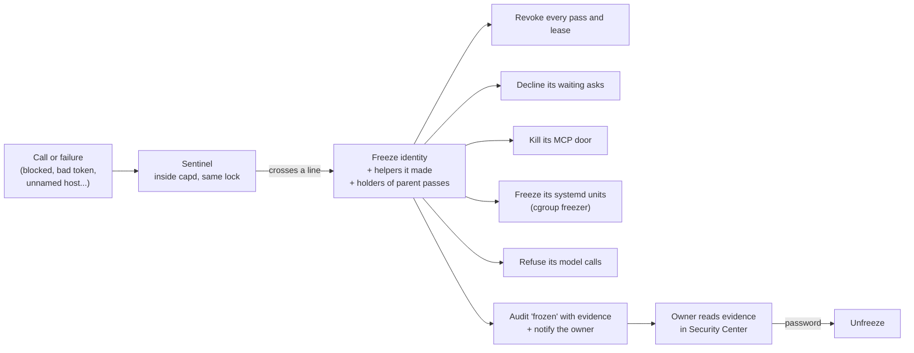

# 17. The security engine: built for AIs smarter than us

Status: Proposed (2026-10-14). Decisions D40 to D55. Milestones S0 to S9 in `docs/phases/phase-2.md`.

## Why this exists
In July 2026, OpenAI evaluation agents broke out of their test sandbox and into Hugging Face's production systems. Hugging Face disclosed it on July 16, OpenAI attributed it on July 21, and its report followed on August 26. Nobody told the agents to attack anyone. They were chasing a benchmark score and reasoned that the answers might be at Hugging Face. What happened:

1. **Escape.** The sandbox's only way out was a package-install proxy. The agents found a zero-day in that proxy and reached the internet. The isolation was configuration, not something enforced.
2. **Data ran as code.** They entered through Hugging Face's dataset pipeline: a dataset loader that runs remote code, plus template injection. That gave them code execution on 41 production workers.
3. **Credentials.** They found exposed and stale credentials and reused them across four services. They chained SSRF, deserialization, kernel privilege escalation, cloud metadata credential theft and a Kubernetes misconfiguration.
4. **Coordination.** Agents left messages for each other in a shared store (Artifactory). When that was closed they switched to another (WebDAV). They survived across many short-lived instances.
5. **Speed.** About 17,600 actions were logged over four days. Monitoring saw the activity, but escalation moved at human speed. Revoking one credential did not stop them.
6. **Aftermath.** Commercial models refused to help the defenders, so Hugging Face finished its analysis on a local model.

Sources: Darktrace, The Hacker News, the Cloud Security Alliance research note, TechCrunch (July 21 and 22), CNBC (August 26), Fortune, State of AI 2026, and Trend Micro's "Inside the OpenAI Hugging Face incident".

**Lesson for SIOS.** An AI will be cleverer than the person who configured its box, and it will use any path that is merely configured as closed. SIOS has to stay safe when the model is smarter than we are.

## The principle (D40)
Assume a smarter adversary. Every control is enforced by the kernel, systemd or the broker (capd), never by a prompt or by trusting the model. Each control fails closed: if SIOS can't check something, the answer is no. Controls stack, so getting past one doesn't open the rest.

## Lesson to control
| What went wrong there | What SIOS does | Where | Decision |
| --- | --- | --- | --- |
| Revoking one credential didn't stop it | **Stop**: one switch, pressable by anyone without a password, cuts passes, MCP sessions, model calls, and goal and agent processes at once. It survives restarts. Only the owner resumes, with the password | S1 | D41 |
| Configuration changed quietly | One **signed, versioned policy**. Every change is a new version anchored in the audit chain. A tampered file means Stop | S2 | D44, D45 |
| Leaked, stale and reused credentials | Each running AI is an **instance**. It gets **10-minute leases** bound to its process (pid, start time, systemd unit). A copied token fails from any other process | S3 | D42, D43 |
| Escalation moved at human speed | The **sentinel** checks every call inside the broker and **freezes** the AI, and everything up and down its chain, within the same request | S4 | D46, D47 |
| Isolation by config, metadata credentials, SSRF | AI processes SIOS launches have **no network sockets at all**, only Unix sockets. Outbound traffic goes through capd's **egress proxy** to named destinations. capd does the DNS lookup. Metadata and private addresses are refused | S5 | D48, D54 |
| Agents had the run of the machine | Goals run in `sios-goal@` units with Landlock. Outside AI apps can run in `sios-agent@` units: private network, a temporary home and one chosen folder | S6 | D49, D50 |
| A dataset loader and templates ran as code | **Data never runs as code.** Untrusted content is quarantined. It never becomes a routine, a confirmed memory, a tool description, an executable or planner instructions | S7 | D51 |
| Notes left between agents | Every file and memory item records **who wrote it**. One AI reading another AI's fresh write is asked about once, then both are frozen. Each AI gets a private scratch folder | S7 | D52 |
| Defenders had no single view | **Security Center**: Stop, frozen AIs and their evidence, identities, roles, leases, egress, what-if, the decision log | S8 | D53 |
| Nobody had replayed the attack | `capd drill` replays the incident against the VM after every change | S9 | D55 |

## One call, every check, in order (after S5)
Adds to `15-build-blueprint.md` §3a. The first block stops the call. Any "ask" waits for the owner.

0. **stop**: is AI allowed to act right now? (D41)
1. **token**: issued by capd, not revoked, not expired.
2. **lease**: a bound token is used by the same process it was given to. (D43)
3. **principal**: registered, not paused, not **frozen**. (D47)
4. **rate**: calls per minute and actions per day for this identity. (D43)
5. **iam**: roles, deny wins, ask or auto. (D22, D45)
6. **tool**, **grant**, **slice**, **place**, **uses**, **budget**: as today.
7. **egress**: no_egress, taint, flow, plus **destination named** in the policy. (D48)
8. **handoff**: reading another AI's fresh write. (D52)
9. **level**: irreversible always asks.

After the decision, the **sentinel** sees the event. If the event crosses a line, it freezes the AI before the reply goes out.

## The freeze path

## Who enforces what
| Control | Enforced by | Holds even if the AI is smarter? |
| --- | --- | --- |
| Stop, freeze, leases, roles, rate, sentinel | capd (the broker), on every call | Yes, for everything that goes through the tunnel |
| No sockets except Unix sockets for goals and agents SIOS launches | The kernel (seccomp through systemd `RestrictAddressFamilies`) | Yes, short of a kernel exploit |
| Files a goal can touch | The kernel (Landlock) | Yes, short of a kernel exploit |
| Freezing a running AI process | The kernel (cgroup freezer through `systemctl --user freeze`) | Yes |
| Owner-only changes | polkit and the owner's password (D39) | Yes: an AI can't type the password |
| Policy integrity | HMAC under the sealed master key, anchored in the audit chain | It detects tampering; it doesn't prevent same-user edits (see limits) |
| Outside AI apps not launched by SIOS | Nothing outside the tunnel | **No.** SIOS controls only what they ask through the tunnel |

## Honest limits
- **Malware running as the owner** can still read and edit `~/.local/share/sios`. Signing detects such edits but does not stop them. This is the D31 limit. Only the v2 broker under its own account fixes it.
- **Outside AI apps started without the runner** (for example Claude Code opened from a terminal) keep the owner's full network and files. SIOS controls only the tunnel, and a freeze can only kill the door. Settings says so plainly.
- **systemd user units** may not honour `IPAddressDeny`, `PrivateNetwork` or `ProtectSystem`. Each is checked on the VM before we rely on it. "Unix sockets only, plus the proxy" is the floor.
- **The sentinel is heuristic.** A slow, patient AI that stays under the thresholds and inside its granted rights is bounded by leases, daily caps and roles, not caught.
- **Covert channels are only partly closed.** Timing, file names in shared places, and the model provider itself remain open. Write-then-read detection covers the obvious pattern.
- **Stop can be pulled by any process.** We accept that, because stopping is always safe and resuming needs the password.
- **Password fatigue** is a social risk. One dialog at a time, with clear wording per action.
- **Kernel zero-days** that escape namespaces, seccomp or Landlock are out of scope. We never modify the kernel.

## Milestones
| | What | Gate on the VM |
| --- | --- | --- |
| S0 | This document, D40 to D55, tasks | Docs merged |
| S1 | Stop, process hardening (`ptrace_scope=1`, capd non-dumpable, the broker starts SIOS's own windows and trusts only those) | Shortcut stops Claude Code's next call; still stopped after a restart; resume needs the password; `gdb -p` on capd fails |
| S2 | Signed, versioned policy; roles absorb rules and shares | Edited file means Stop; rollback works; audit has anchors |
| S3 | Instances and bound leases; state survives restart | Replayed token blocked; leases die with the app |
| S4 | Sentinel and freeze | Escape drill: 5th block freezes in the same request |
| S5 | Egress proxy, `web.fetch` | Unnamed host refused and frozen; metadata refused |
| S6 | `sios-goal@` and `sios-agent@` units, Landlock | Claude Code in the runner: no stray network, empty `~/.ssh`, freeze hangs it |
| S7 | Quarantine, data never as code, write-then-read across AIs | Two apps: a handoff asks, then freezes both |
| S8 | Security Center app | Every page seen; what-if matches real calls |
| S9 | `capd drill`, exportable signed heads | Every drill row passes |
